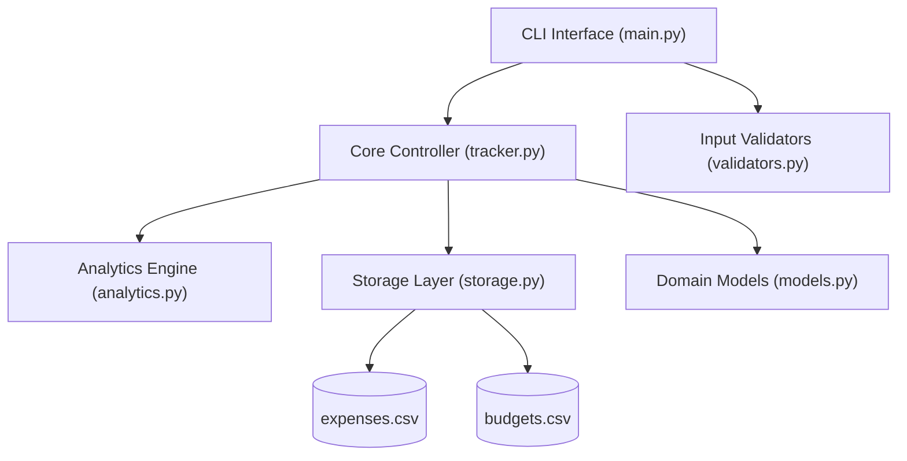

# Personal Expense & Budget Tracker

An automated personal finance tracker enabling users to record daily expenditures, aggregate category-wise spending, and generate real-time budget analytics with modular CSV persistence.

Built by **Vishanth R** (B.Tech in Computer Science & Engineering - AI & Data Engineering, Jain University).

---

## 🎯 Alignment with Resume Highlights

| Resume Specification | Implementation Detail |
| :--- | :--- |
| **Record Daily Expenditures** | Interactive CLI workflows with auto-date parsing (`today` or `YYYY-MM-DD`), numeric validation, categorized selection, and payment method attribution (UPI, Cards, Cash). |
| **Aggregate Category-Wise Spending** | Dynamically calculates spending per category (Food & Dining, Transportation, Education, Tech, etc.), computing exact totals and percentage share of total expenditure. |
| **Real-Time Budget Analytics** | Live tracking of overall and category-specific monthly spending caps, computing remaining allowances, consumption metrics, and trigger thresholds (Healthy, 80% Warning, and Over-Budget alerts). |
| **Modular CSV Parsing & Persistence** | Dedicated `storage.py` layer using standard library `csv.DictReader` and `csv.DictWriter`, atomic file swapping via temporary staging files, and automated `.backup` snapshot generation. |
| **Robust Error Handling & Validation** | `validators.py` rejects corrupt rows, malformed dates, invalid numbers, and unknown categories without crashing, logging diagnostic warnings. |
| **Visual CLI Analytics** | Dynamic terminal ASCII progress bars displaying spending distribution and budget consumption directly in the console. |

---

## 🏗️ Architecture & Modules



- **`models.py`**: Dataclasses for `Expense` and `MonthlyBudget` with dictionary serialization.
- **`validators.py`**: Strict format validation for ISO dates, amounts, categories, and payment methods.
- **`storage.py`**: CSV reader/writer with corrupted row skipping, atomic writes, and seed generator.
- **`analytics.py`**: Category aggregation, monthly filters, budget warnings, and ASCII progress bar visualizer.
- **`tracker.py`**: High-level manager coordinating CRUD operations, search filters, and reporting.
- **`main.py`**: Menu-driven terminal UI with formatted tables, color highlights, and export capabilities.
- **`test_expense_tracker.py`**: Unit test suite verifying models, validators, storage, and analytics.

---

## 📁 Directory Structure

```
03-personal-expense-tracker/
├── data/
│   ├── expenses.csv             # Persistent CSV record store
│   └── budgets.csv              # Monthly budget configuration store
├── models.py                    # Expense and MonthlyBudget data models
├── validators.py                # Data format and boundary validators
├── storage.py                   # Modular CSV persistence and backup engine
├── analytics.py                 # Category aggregation & budget metrics engine
├── tracker.py                   # Business logic coordinator
├── main.py                      # Interactive terminal CLI application
├── test_expense_tracker.py      # Automated unit test suite (10 test cases)
├── run.bat                      # Windows launcher script
├── run_tests.bat                # Automated test runner script
└── README.md                    # Documentation
```

---

## 🚀 Getting Started

### Prerequisites
- Python 3.8+ (tested on Python 3.14)
- Standard library only — no external third-party dependencies required!

### 1. Run the Interactive CLI Application
Double-click `run.bat` or run in terminal:
```bash
python main.py
```

### 2. Run Automated Unit Tests
Double-click `run_tests.bat` or run in terminal:
```bash
python -m unittest test_expense_tracker.py
```

---

## 📊 Sample CLI Output

### Category-Wise Spending Analytics with ASCII Bar Visualization
```text
================================================================================
  CATEGORY SPENDING FOR 2026-09 (Total Spend: Rs. 4,808.00)
================================================================================
  Category               | Amount (Rs)  | Share   | Visual ASCII Distribution
  -----------------------+--------------+---------+-------------------------------
  Food & Dining          |      1700.00 |   35.4% | [========----------------]
  Education & Books      |      1300.00 |   27.0% | [======------------------]
  Tech & Software        |       799.00 |   16.6% | [====--------------------]
  Transportation         |       510.00 |   10.6% | [===---------------------]
  Healthcare             |       300.00 |    6.2% | [=-----------------------]
  Entertainment          |       199.00 |    4.1% | [=-----------------------]
================================================================================
```

### Real-Time Monthly Budget Tracker & Threshold Alerts
```text
================================================================================
             BUDGET HEALTH & ANALYTICS REPORT (2026-09)
================================================================================
  Monthly Expenditure : Rs. 4,808.00
  Overall Budget Cap  : Rs. 8,000.00
  Remaining Allowance : Rs. 3,192.00
  Budget Consumption  : 60.1%
  Overall Utilization : [=================-----------]
  ALERT STATUS        : [HEALTHY: Spending is within planned limits]
--------------------------------------------------------------------------------
  CATEGORY-LEVEL BUDGETS & THRESHOLDS:
  Category               | Spent (Rs)  | Limit (Rs)  | Used %  | Status
  -----------------------+-------------+-------------+---------+-----------------
  Food & Dining          |     1700.00 |    2,500.00 |   68.0% | [HEALTHY]
  Education & Books      |     1300.00 |    2,000.00 |   65.0% | [HEALTHY]
  Tech & Software        |      799.00 |    1,200.00 |   66.6% | [HEALTHY]
  Transportation         |      510.00 |    1,200.00 |   42.5% | [HEALTHY]
  Healthcare             |      300.00 |      500.00 |   60.0% | [HEALTHY]
  Entertainment          |      199.00 |      600.00 |   33.2% | [HEALTHY]
================================================================================
```
